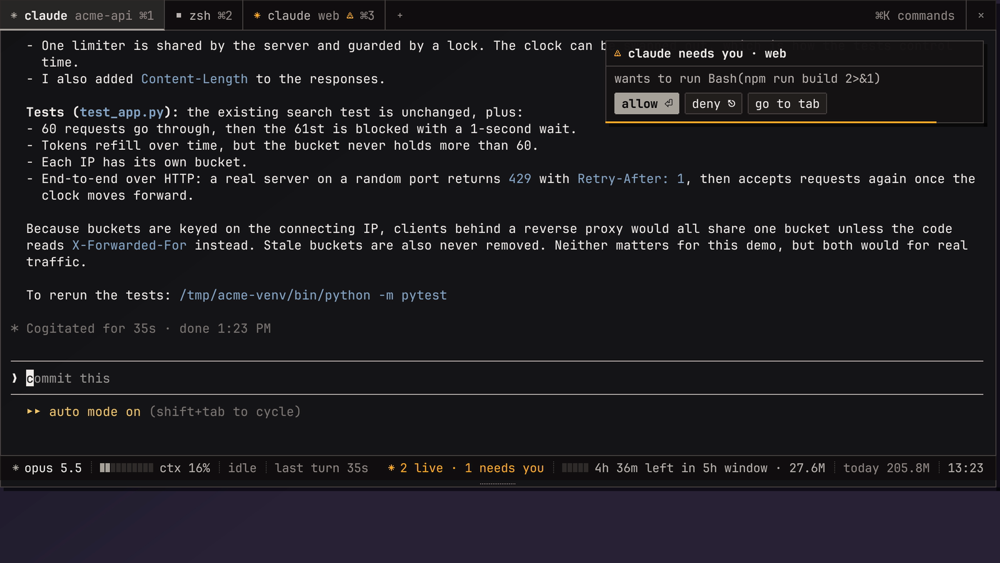
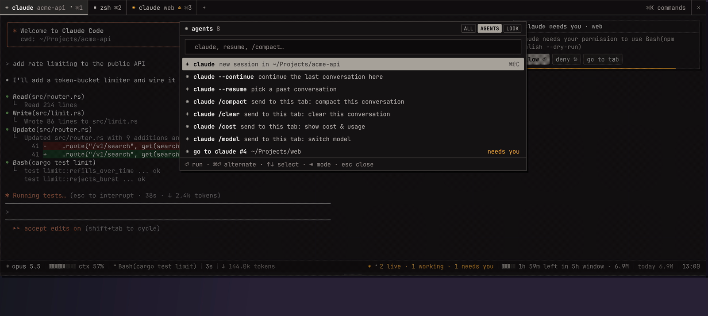
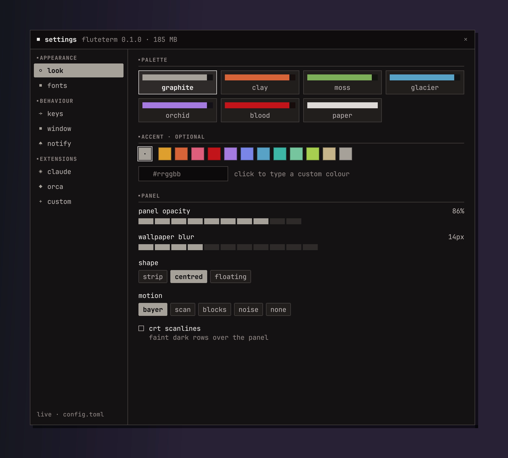

<div align="center">

# ▼ fluteterm

**The drop-down terminal for macOS, built for the agent era.**

Press <kbd>F12</kbd>: a terminal slides down from under the menu bar, Quake/Yakuake style.
Every tab keeps running when you close it, and your Claude Code sessions report what they're doing.

[Website](https://vuhiza.github.io/fluteterm/) · [Install](#install) · [Features](#features) · [Claude Code](#claude-code) · [Customise](#customise)



</div>

## Install

```sh
brew install vuhiza/tap/fluteterm
```

Then run `fluteterm` and press <kbd>F12</kbd> (<kbd>fn</kbd>+<kbd>F12</kbd> on laptop keyboards).
To start it at login: `brew services start fluteterm`.

Requires macOS 12+. Homebrew builds it from source, so there's no Gatekeeper prompt, and
installs `tmux` for persistent tabs.

<details>
<summary>Build from source instead</summary>

```sh
git clone https://github.com/vuhiza/fluteterm && cd fluteterm
./scripts/install.sh            # ~/Applications/fluteterm.app + ~/.local/bin/fluteterm
./scripts/dmg.sh                # or: a drag-to-Applications disk image in dist/
```

Needs Rust 1.85+.
</details>

## Features


- **Drop-down, everywhere.** A global hotkey (F12 by default, any combination you record), on the
  screen under the mouse, over full-screen apps and on every Space. It's see-through with a
  native background blur.
- **Looks like pixel art, reads like a terminal.** Text is smooth JetBrains Mono. The pixel feel comes
  from crisp 1px details, dithered textures and stepped, dissolving motion.
- **Tabs that survive anything.** Quit fluteterm and your shells, builds and Claude sessions keep
  running (invisibly, via tmux); start it again and they're all back. After a reboot, tabs reopen in
  their directories and Claude tabs resume their conversations.
- **Claude Code built in.** Per-tab state (thinking, running a tool, needs you), model and context
  meter, the 5-hour usage window, and allow / deny for permission prompts without switching tabs.
- **Orca built in.** Worktrees and agents in the status bar, ⌘⇧O to browse them, live attach to an
  agent's terminal, notifications when agents finish or need you.
- **Command palette (⌘K)** for everything: tabs, agents, themes, settings.
- **A real settings window (⌘,)**: themes, an optional accent colour, fonts, a hotkey recorder,
  window, notifications and extensions. Every change applies live.
- **Native macOS:** menu-bar item, Notification Center banners, shortcuts that work in any input
  language, copy-on-select, selections that survive redraws.
- **Fast and small:** about 70 MB of memory, 0% CPU when idle, written in Rust.
- **Optional integrations:** without Claude Code or Orca installed, none of their UI appears.



## Keys

| key | action |
|---|---|
| <kbd>F12</kbd> (global) | drop down / pull up |
| <kbd>⌘T</kbd> / <kbd>⌘W</kbd> | new tab (same directory) / close tab |
| <kbd>⌘1</kbd>…<kbd>⌘9</kbd>, <kbd>⌘⇧[</kbd> <kbd>⌘⇧]</kbd> | switch tabs |
| <kbd>⌘K</kbd> | command palette |
| <kbd>⌘⇧C</kbd> | new Claude Code session here |
| <kbd>⌘⇧O</kbd> / <kbd>⌘⇧A</kbd> | Orca worktrees / agent commands |
| <kbd>⌘,</kbd> | settings |
| <kbd>⌘C</kbd> / <kbd>⌘V</kbd> | copy / paste (selecting also copies) |
| <kbd>⌘+</kbd> <kbd>⌘-</kbd> <kbd>⌘0</kbd> | text size |
| <kbd>⌘</kbd>-click | open URL or path |
| <kbd>⇧</kbd>-drag | select even inside mouse-driven apps |

## Claude Code

```sh
fluteterm install claude        # or Settings → claude → install hooks
```

This adds hooks to `~/.claude/settings.json`. It backs the file up first, only ever touches
fluteterm's own entries, and is removable any time with Settings → claude → remove hooks.

- **Tabs:** `✻ claude <project>` shows a spinner while working, ⚠ when it needs you, ✓ when done.
- **Status bar:** model, a context-window meter, the current tool and turn time. On every tab you
  also see live sessions, the **5-hour usage window** and **today's tokens** across every Claude
  Code session on your Mac.
- **Permission prompts:** a pop-up with **allow ⏎ / deny ⎋ / go to tab** answers Claude from
  wherever you are. When the panel is hidden, Notification Center banners take you to the right tab.
- **Palette:** new session, `--continue`, `--resume`, `/compact`, `/clear`, jump to any Claude tab.

## Customise



Everything lives in `~/.config/fluteterm/config.toml` (commented and live-reloaded) and in the
settings window:

```toml
hotkey = "F12"
theme  = "graphite"   # graphite clay moss glacier orchid blood paper
accent = "#3fb8a8"    # optional

[window]
height = 0.5
shape  = "strip"      # strip | centred | floating
blur   = 14

[session]
backend = "auto"      # tmux keeps processes alive; plain restores layout
```

**Themes** are one accent colour plus optional overrides in `~/.config/fluteterm/themes/*.toml`.

**Code-free extensions:** `[[profile]]` adds tab types with shortcuts, `[[module]]` adds
status-bar segments fed by any command, and `[[command]]` adds palette entries. Examples are in
the generated config.

<br clear="right">

## Scripting

The `fluteterm` binary is also a remote control. Commands go over a unix socket as
newline-delimited JSON.

```sh
fluteterm open claude --cwd ~/code/app     # new tab
fluteterm send --tab 3 'cargo test\n'      # type into a tab
fluteterm notify "deploy" "done" --level ok
fluteterm status ci "✓ green"              # custom status-bar segment
fluteterm read --tab 3                     # a tab's visible text
fluteterm do "theme: clay"                 # run any palette command
fluteterm list                             # tabs as JSON
```

Every tab exports `FLUTETERM_TAB_ID`, so scripts can address their own tab.

## Credits

Built on [alacritty_terminal](https://github.com/alacritty/alacritty) and
[winit](https://github.com/rust-windowing/winit); the macOS display code is fluteterm's own
(`src/platform/present.rs`). Font: [JetBrains Mono](https://www.jetbrains.com/lp/mono/) (OFL).
Visual direction inspired by [yami](https://github.com/Trendorin/yami).

MIT © vuhiza
